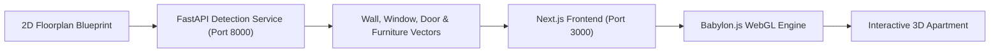

# 🏠 3D Apartment Viewer

An interactive web application that converts 2D architectural floorplan blueprints into navigable 3D apartment spaces using automated structural segmentation and WebGL 3D rendering (**Babylon.js**).

---

## 🌟 Key Features

* **📐 Automated Floorplan Vectorization:**
  * Analyzes uploaded 2D floorplan images to extract and classify architectural elements:
    * Structural exterior and interior walls (orthogonal centerline graph)
    * Windows & glass openings aligned to wall segments
    * Doorways & entry openings
    * Interior furniture (beds, sofas, tables, chairs, desks, wardrobes, cabinets)
* **🧱 Real-time 3D Wall Extrusion:**
  * Extrudes 2D wall polylines into full-height 3D architectural geometry with customizable scale (`px/m`), wall height, and wall thickness.
* **✂️ CSG Boolean Geometry Cutouts:**
  * Uses **Constructive Solid Geometry (CSG)** to carve window openings (at configurable sill heights) and doorway openings directly into 3D wall meshes.
* **🛋️ Automated & Manual 3D Furnishing:**
  * One-click **Auto-Furnish** populates rooms with matching 3D GLTF furniture models (`Bed1.glb`, `Sofa1.glb`, `TableB1.glb`, `Chair1.glb`, `Desk1.glb`, `Storage1-4.glb`) at detected blueprint coordinates, or place and drag models manually.
* **🎮 Interactive 3D Walkthrough:**
  * Smooth WASD keyboard navigation, mouse orbit/zoom controls, drag-and-drop model repositioning, `R` key rotation, `Delete` key removal, and JSON scene export/import.
* **🗄️ Full-Stack Project Management:**
  * User authentication, SQLite database persistence (`better-sqlite3`), and saved blueprint dashboard.

---

## 🛠️ Architecture & Tech Stack



* **Frontend:** Next.js, React, Babylon.js (WebGL, PBR materials, Shadows, CSG).
* **Backend:** Python, FastAPI, Uvicorn, Structural Segmentation & Vectorization Engine.
* **Database:** SQLite (`better-sqlite3`), Session Auth (`bcryptjs`).

---

## 🚀 Quick Start

### Option 1: 1-Click Launch (Windows)
Double-click [`start-project.bat`](start-project.bat) to launch both the Python detection backend and the Next.js web server simultaneously.

### Option 2: Manual Setup

#### 1. Start Floorplan Detection Backend
```bash
cd backend
# Create virtual environment and install dependencies
uv venv .venv --python 3.12
uv pip install -r requirements.txt

# Launch server
.\.venv\Scripts\python.exe -m uvicorn app:app --port 8000 --host 127.0.0.1
```

#### 2. Start Next.js Frontend
```bash
# In the project root:
npm install
npm run dev
```

Open [http://localhost:3000](http://localhost:3000) in your browser.

---

## 👤 Author
Developed by **Martin Nedkov** ([@MNedkov09](https://github.com/MNedkov09)).
