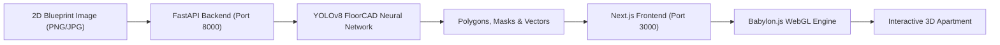

# 🏠 3D Apartment Viewer & AI Floorplan Detector

An automated web application that reconstructs 2D architectural blueprints into fully interactive, navigable 3D spaces using Deep Learning (**YOLOv8 FloorCAD Segmentation**) and WebGL 3D rendering (**Babylon.js**).

---

## 🌟 Key Features

* **🤖 AI-Powered Floorplan Segmentation:**
  * Uses a fine-tuned **YOLOv8-seg** model trained on architectural CAD drawings to segment:
    * Structural walls
    * Windows & Bay windows
    * Doors (single, double, sliding)
    * Furniture (beds, sofas, tables, chairs, cabinets, desks)
  * **Hybrid Cleaning Pipeline:** Subtracts furniture, dimensions, and text annotations to produce a clean 1-pixel centerline skeleton without classical CV artifacts.
* **⚡ Classical CV vs. AI Toggle:**
  * Interactive switch between **Deep Learning YOLOv8** and **Classical OpenCV** skeletonization to compare and benchmark methods in real time.
* **🧱 Real-time 3D Wall Generation:**
  * Extrudes wall ribbons from 2D vector coordinates into 3D volumes.
* **✂️ CSG Boolean Geometry Cutouts:**
  * Utilizes **Constructive Solid Geometry (CSG)** to physically carve window openings (at configurable sill heights) and full-height door openings directly through 3D walls.
* **🛋️ AI Auto-Furnishing:**
  * Automatically populates rooms with matching 3D GLTF furniture models (`Bed1.glb`, `Sofa1.glb`, `TableB1.glb`, `Desk1.glb`, etc.) based on detected labels and orientations.
* **🎮 Interactive 3D Walkthrough:**
  * Smooth WASD movement, mouse orbit controls, model dragging, rotation, deletion, and full JSON scene export/import.
* **🗄️ Full-Stack Project Management:**
  * User authentication, SQLite database storage (`better-sqlite3`), and saved blueprint history.

---

## 🛠️ Architecture & Tech Stack



* **Frontend:** Next.js, React, Babylon.js (WebGL, PBR materials, Shadows, CSG).
* **Backend:** Python, FastAPI, Uvicorn, Ultralytics YOLOv8, OpenCV (Thinning & Morphological filters).
* **Database:** SQLite (`better-sqlite3`), Session Auth (`bcryptjs`).

---

## 🚀 Quick Start

### Option 1: 1-Click Launch (Windows)
Double-click [`start-project.bat`](start-project.bat) to launch both the Python AI detector backend and the Next.js development server simultaneously.

### Option 2: Manual Setup

#### 1. Start Python AI Backend
```bash
cd backend
# Create virtual environment and install dependencies
uv venv .venv --python 3.12
uv pip install -r requirements.txt

# Launch server
.\.venv\Scripts\python.exe -m uvicorn app:app --port 8000 --host 127.0.0.1
```

#### 2. Start Next.js Frontend
```bash
# In the project root:
npm install
npm run dev
```

Open [http://localhost:3000](http://localhost:3000) in your browser.

---

## 📊 Evaluation & Benchmarks

| Feature | Classical OpenCV Pipeline | YOLOv8-seg AI Pipeline |
| :--- | :--- | :--- |
| **Wall Extraction** | Distorted by text & furniture | Clean structural walls isolated |
| **Door Detection** | Door arcs misclassified as walls | Detected as opening with rotation angle |
| **Windows** | Heuristic hole contours only | Detected with exact bounds & CSG cutout |
| **Furniture** | Creates messy spiderwebs | Classified & auto-furnished with 3D GLTF models |
| **Inference Time** | ~400ms (browser WASM) | ~60ms - 140ms (Python server) |

---

## 👤 Author
Developed by **Martin Nedkov** ([@MNedkov09](https://github.com/MNedkov09)).
